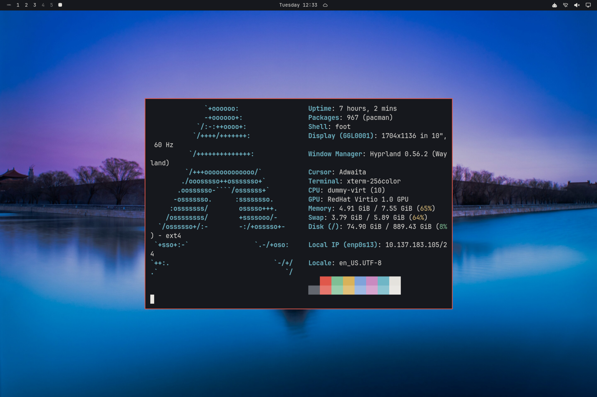

# 北京·夜 Beijing Night

夜色为底、灰墙为字、中国红为印、天坛蓝点缀的深色主题。壁纸：天坛、故宫角楼、天安门、长城。



## 安装

```bash
omarchy theme install https://github.com/rwanglq-ctrl/omarchy-beijing-night-theme
```

## 壁纸来源

1. [天坛祈年殿夜景](https://unsplash.com/photos/a-view-of-a-building-at-night-from-a-wall-Ks-O02vt7UI) — krzhck，Unsplash License（Unsplash）
2. [故宫角楼蓝调时刻](https://unsplash.com/photos/a-large-building-sitting-on-top-of-a-lake-eXp5ohIZpQ4) — Dragon Pan，Unsplash License（Unsplash）
3. [Tiananmen 2016 April night (19-00).jpg](https://commons.wikimedia.org/wiki/File:Tiananmen_2016_April_night_%2819-00%29.jpg) — Morio，CC BY-SA 4.0（Wikimedia Commons）；已裁切、缩放
4. [长城日出](https://unsplash.com/photos/great-wall-of-china-at-sunrise-with-rolling-hills-yke8EMYRius) — Sammy Wong，Unsplash License（Unsplash）

## 许可

- 壁纸：Wikimedia Commons 照片按各自 CC 许可署名，改编版以 CC BY-SA 4.0 提供；Unsplash 照片依 Unsplash License 使用
- 配色与配置文件：MIT

详见 [LICENSE](LICENSE)。
